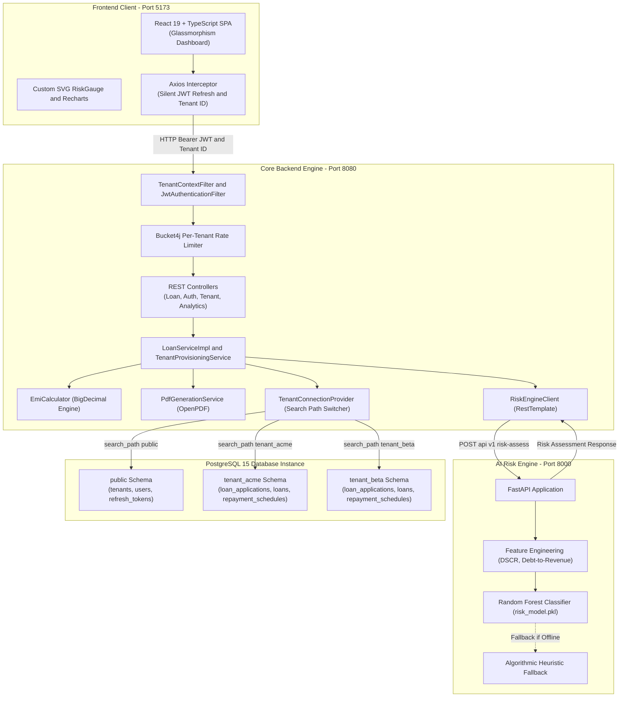

# 🚀 AI-Powered Multi-Tenant B2B Lending Engine


> [!IMPORTANT]
> ### 📌 Recruiter & Reviewer Quick Links (3 Repositories)
> This enterprise platform is engineered as a decoupled polyglot microservice architecture across 3 independent repositories:
> 
> | Component | Repository Link | Role | Technology Stack |
> | :--- | :--- | :--- | :--- |
> | ☕ **Core Backend API** | [**lending-engine-java-api**](https://github.com/Aryan-Raval02/lending-engine-java-api) | Core Transactional Backend & Schema Multi-Tenancy | Java 21, Spring Boot 3.4, PostgreSQL, Flyway |
> | 🧠 **AI Risk Engine** | [**lending-engine-python-ml**](https://github.com/Aryan-Raval02/lending-engine-python-ml) | Real-Time Credit Scoring & ML Underwriting | Python 3.10+, FastAPI, Scikit-Learn, Pandas |
> | ⚛️ **Frontend Portal** | [**lending-engine-frontend**](https://github.com/Aryan-Raval02/lending-engine-frontend) | Glassmorphism Dashboard UI & Risk Visualizer | React 19, TypeScript, Vite, Recharts |

---

## 2. Short Description

The **AI-Powered Multi-Tenant B2B Lending Engine** is an enterprise-grade fintech platform engineered to automate commercial loan origination, credit underwriting, and repayment scheduling. Powered by a polyglot microservice architecture, it combines a transactional **Java 21 / Spring Boot 3.4** backend with dynamic schema-per-tenant isolation, a dedicated **Python / FastAPI** AI Risk Engine with Random Forest predictive scoring, and a high-performance **React 19 / TypeScript / Vite** glassmorphism dashboard.

---

## 3. Demo / Screenshots

### End-to-End System Workflow

```
[Borrower Portal (React 19)]
           │ 
           ▼ (POST /loans/applications)
[Spring Boot Backend] ──(HTTP POST)──► [Python FastAPI AI Risk Engine]
           │                                    │
           │◄───(Score: 85, LOW Risk, DSCR: 2.1)┘
           ▼
[Status: PENDING_OFFICER_REVIEW]
           │
     [Underwriter Reviews via Visual Risk Gauge]
           │
           ├────────────────────────────┐
           ▼                            ▼
      [REJECTED]                   [APPROVED]
                                        │
                                        ▼ (POST /loans/applications/{id}/disburse)
                                   [DISBURSED]
                                        │
                         ┌──────────────┴──────────────┐
                         ▼                             ▼
              [Active Loan & Ledgers]     [Amortization Schedule & OpenPDF]
```

### Visual Interface & API Capabilities
- **Role-Adaptive Dashboard**: Dynamic viewports tailored specifically for corporate Borrowers vs Underwriting Loan Officers.
- **Interactive SVG Risk Gauge**: Real-time gauge plotting AI credit scores (0–100) with dynamic gradient arcs and categorical badges.
- **Precision Amortization Schedules**: Exact zero-balance installment tables amortizing principal and interest with downloadable PDF agreements.
- **Interactive API Documentation**: Swagger UI at `http://localhost:8000/docs` and Spring Boot Actuator at `http://localhost:8080/actuator/health`.

---

## 4. Problem Statement

Commercial B2B lending involves substantial financial risk and regulatory obligations. Traditional lending platforms suffer from critical deficiencies:
1. **Multi-Tenant Data Bleed**: Shared database tables relying only on `tenant_id` WHERE clauses are susceptible to critical data leakage between competing commercial clients.
2. **Subjective & High-Latency Underwriting**: Manual analysis of balance sheets, DSCR, and corporate debt creates underwriting bottlenecks taking days or weeks.
3. **Floating-Point Precision Drift**: Standard IEEE 754 floating-point arithmetic introduces discrepancies that violate financial auditing and compliance standards over multi-year amortization schedules.
4. **Monolithic Coupling**: Coupling heavy predictive analytics directly to payment transaction ledgers creates single points of failure.

This engine overcomes these barriers through **schema-per-tenant isolation**, **decoupled machine learning with resilient fallback heuristics**, and **pure `BigDecimal` precision mathematics**.

---

## 5. Key Features

- **Schema-Per-Tenant Isolation**: Dynamically provisions dedicated PostgreSQL schemas (`tenant_{tenant_id}`) on tenant signup, transparently switching connections via Hibernate's `MultiTenantConnectionProvider`.
- **AI-Driven Credit Underwriting**: Python microservice employing a Random Forest Classifier trained on B2B loan datasets to output default probabilities, credit scores (0–100), and explainable factors.
- **Resilient Heuristic Fallback**: Automatic failover to an internal mathematical DSCR and leverage penalty engine if the ML service is temporarily offline.
- **Arbitrary-Precision Amortization Math**: Strictly calculates EMIs, monthly interest accruals, and principal reductions using `BigDecimal` with 15-digit `MathContext.HALF_UP` precision.
- **Per-Tenant Token-Bucket Rate Limiting**: Embedded Bucket4j rate limiting (100–500 req/min per tenant) protecting against noisy-neighbor attacks.
- **Stateless JWT Security & Token Rotation**: JJWT implementation with 15-minute access tokens and 7-day database-backed refresh token rotation with immediate revocation upon logout.
- **Dual-Role Dark Glassmorphism UI**: React 19 single-page application featuring custom SVG risk gauges, Recharts portfolio distributions, and silent JWT refresh interceptors.
- **Dynamic PDF Generation**: Generates official loan agreements and repayment schedules using OpenPDF.

---

## 6. Architecture Diagram



---

## 7. Tech Stack

| Domain | Technologies |
| :--- | :--- |
| **Backend Core** | Java 21, Spring Boot 3.4.1, Spring Data JPA, Hibernate Multi-tenancy |
| **AI / ML Microservice** | Python 3.10+, FastAPI, Uvicorn, Scikit-Learn, Pandas, NumPy, Pydantic |
| **Frontend UI** | React 19.2, TypeScript ~6.0, Vite 8.2, React Router DOM 7, Vanilla CSS3 Glassmorphism |
| **Database & Migrations** | PostgreSQL 15+, Flyway Database Migrations |
| **Security & Auth** | Spring Security 6, JJWT 0.12.6, BCrypt, Stateless JWT Token Rotation |
| **Visualization & Reporting** | Recharts, Custom SVG Gauges, OpenPDF (LibrePDF) |
| **Rate Limiting** | Bucket4j Core 8.10.1 |
| **DevOps & Containers** | Docker (Eclipse Temurin JRE 21), Maven Wrapper, Vercel SPA Deployments |

---

## 8. Repository Links (3 repos)

The platform is split into 3 independent, purpose-built GitHub repositories:

| Repository Name | Role | Technology Stack | Link |
| :--- | :--- | :--- | :--- |
| **lending-engine-java-api** | Core Transactional Backend | Java 21, Spring Boot 3, PostgreSQL, Flyway | [lending-engine-java-api](https://github.com/Aryan-Raval02/lending-engine-java-api) |
| **lending-engine-python-ml** | AI Risk Scoring Microservice | Python, FastAPI, Scikit-Learn, Pandas | [lending-engine-python-ml](https://github.com/Aryan-Raval02/lending-engine-python-ml) |
| **lending-engine-frontend** | Glassmorphism Dashboard UI | React 19, TypeScript, Vite, Recharts | [lending-engine-frontend](https://github.com/Aryan-Raval02/lending-engine-frontend) |

---

## 9. Setup Instructions

### Prerequisites
- **JDK 21** installed
- **Node.js 18+** installed
- **Python 3.10+** installed
- **PostgreSQL 15+** running on `localhost:5432`

---

### 1. Database Setup
```sql
CREATE DATABASE lending_engine_db;
```

---

### 2. Run the Java Spring Boot Backend
```bash
cd backend/lending-engine
./mvnw clean package -DskipTests
./mvnw spring-boot:run
```
*API server runs on `http://localhost:8080`.*

---

### 3. Run the Python AI Risk Engine
```bash
cd backend/ai-risk-engine
python -m venv venv

# Activate venv:
# Windows: .\venv\Scripts\activate | macOS/Linux: source venv/bin/activate
pip install -r requirements.txt

# (Optional) Generate data and train model:
python ml/data_generator.py
python ml/train_model.py

# Start FastAPI server:
uvicorn main:app --host 0.0.0.0 --port 8000 --reload
```
*AI Risk API runs on `http://localhost:8000` (Docs at `http://localhost:8000/docs`).*

---

### 4. Run the React Frontend
```bash
cd frontend
npm install
npm run dev
```
*Frontend runs on `http://localhost:5173`.*

---

### 5. Automated E2E Testing
Execute the pre-configured [docs/e2e-flow.http](file:///d:/AI-Powered%20Multi-Tenant%20B2B%20Lending%20Engine/docs/e2e-flow.http) file in VSCode with the REST Client extension to run through:
1. Tenant registration & automatic schema provisioning
2. Borrower creation & role assignments
3. Loan application submission
4. Real-time AI risk evaluation
5. Underwriter approval & disbursement
6. Amortization schedule verification

---

## 10. My Contributions

- **Architected Multi-Tenant Data Isolation**: Implemented dynamic schema-per-tenant routing in Hibernate via `TenantConnectionProvider` and Flyway migrations, providing complete data isolation across enterprise clients.
- **Engineered Financial Computation Core**: Designed `EmiCalculator` with strict `BigDecimal` 15-digit precision and `RoundingMode.HALF_UP`, eliminating floating-point rounding errors.
- **Built Machine Learning Underwriting Pipeline**: Developed the Python FastAPI service, engineered DSCR and leverage features, trained the Random Forest model, and established an automated heuristic fallback.
- **Engineered Secure Authentication & Session Recovery**: Built a stateless JJWT architecture with refresh token rotation on the backend, complemented by silent Axios response interceptors on the frontend.
- **Designed Bespoke Glassmorphism UI**: Created the React 19 dark-mode interface, mathematical SVG `<RiskGauge />` component, and integrated PDF export.

---

## 11. Future Enhancements

- [ ] **Asynchronous Event Architecture**: Incorporate Apache Kafka for decoupled event streams (`LoanApprovedEvent`, `PaymentReceivedEvent`).
- [ ] **Explainable AI (XAI) with SHAP**: Implement TreeSHAP explainability for visual credit factor attribution.
- [ ] **OpenTelemetry APM**: Add distributed tracing and Prometheus/Grafana dashboards for monitoring microservice latencies.
- [ ] **Direct Payment Rails**: Connect Plaid for bank account verification and Stripe ACH for automated EMI debits.
- [ ] **Container Orchestration**: Provide Docker Compose and Kubernetes Helm charts for one-command production clusters.

---

## 12. Contact

**Aryan Raval** — Full-Stack & Systems Engineer  
- **GitHub**: [@Aryan-Raval02](https://github.com/Aryan-Raval02)  
- **Email**: [aryanraval299@gmail.com](mailto:aryanraval299@gmail.com)  
- **Profile**: [https://github.com/Aryan-Raval02](https://github.com/Aryan-Raval02)  
